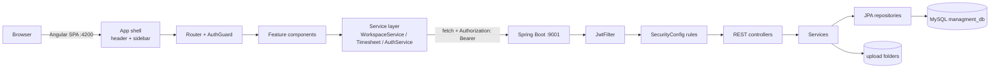
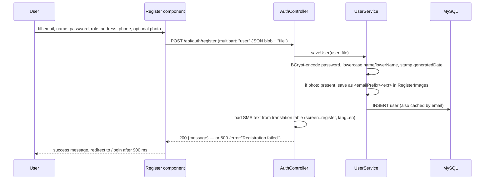
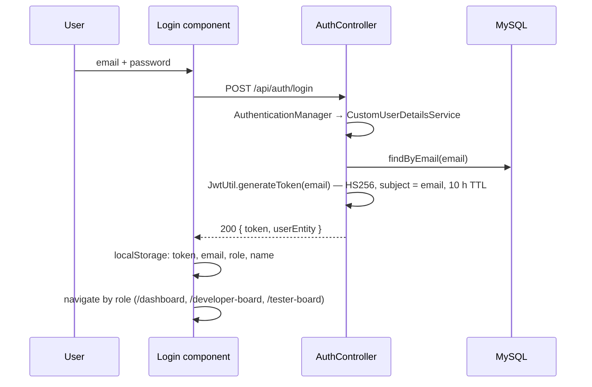
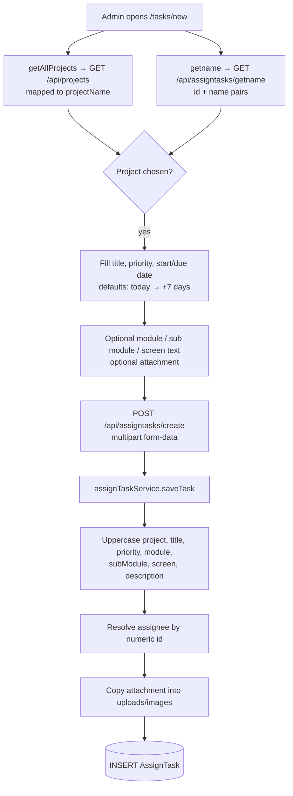
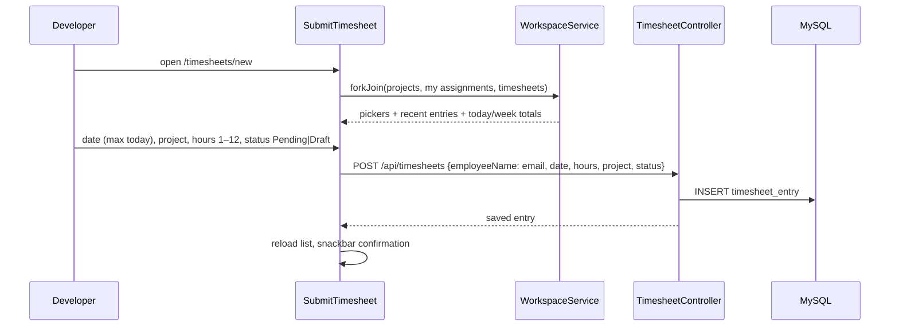
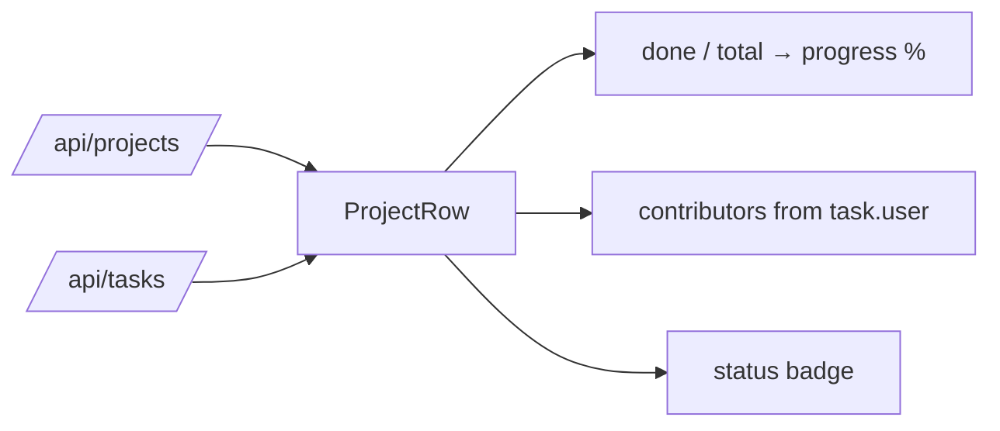
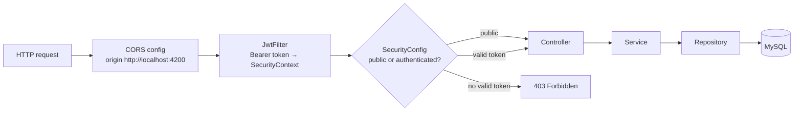
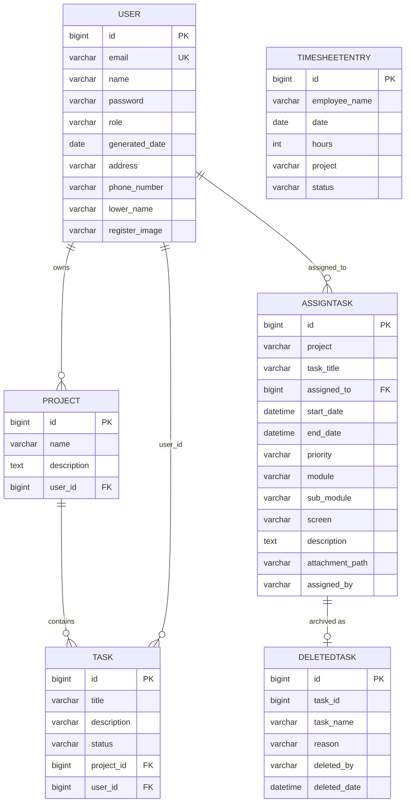
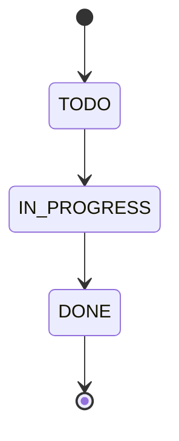

# Employee Management System (EMS) — Detailed Workflow Document

**Version:** 1.0
**Scope:** End-to-end functional and technical workflow of the Angular frontend (`FrontEndCode_EMS-main`) and the Spring Boot backend (`SpringCode_EMS-main`).
**Audience:** Developers, reviewers, and maintainers who need to understand how a user action travels through the system, which tables it touches, and where to change behaviour.

---

## 1. Purpose of the system

The application tracks software delivery work for a small team:

1. An **administrator** registers people and assigns work with a project, owner, priority and deadline.
2. A **developer / tester** sees only their own assignments, reports progress context, and logs the hours they worked against a project.
3. The **workspace dashboards** aggregate the same data into team size, project progress, open work, and logged hours.

---

## 2. System landscape

| Layer | Technology | Location | Runtime |
|---|---|---|---|
| UI | Angular 20, standalone components, Angular Material 20 (dark theme), zone.js change detection | `d:\project-new\FrontEndCode_EMS-main` | `http://localhost:4200` |
| API | Spring Boot 2.4.0, Java 8, Spring Security + JWT (jjwt 0.11.5), Spring Data JPA | `d:\project-new\SpringCode_EMS-main` | `http://localhost:9001` |
| Data | MySQL 8, schema `managment_db` (Hibernate `ddl-auto=update`) | `localhost:3306` | root / root |
| Files | Two upload folders from `application.properties` | `D:/project-new/uploads/images/` and `D:/project-new/uploads/RegisterImages/` | served via `GET /attachments/**` |

> Note: the Maven artifact and the root Java package are still named `canteenManagment`. That name is historical — the code inside is the EMS domain (users, projects, tasks, timesheets).

---

## 3. High-level architecture



---

## 4. Roles and access

The role is a plain string on `user.role` with three supported values.

| Value | Label in UI | Landing page after login | Sidebar items granted |
|---|---|---|---|
| `ADMIN` | Admin | `/dashboard` | Admin Dashboard, Developer Board, Tester Board, My Tasks, Task Board, Create Task, All Tasks, Project Overview, My Projects, Employee Directory, Registered Employees, Submit Timesheet, View Timesheets, Update Profile, Settings |
| `EMPLOYEE` | Developer | `/developer-board` | Developer Board, My Tasks, Task Board, My Projects, Submit Timesheet, Update Profile, Settings |
| `TESTER` | Tester | `/tester-board` | Tester Board, My Tasks, Task Board, My Projects, Submit Timesheet, Update Profile, Settings |

**Where the gate lives**

- Sidebar visibility: `src/app/layout/sidebar/sidebar.ts` — `isVisible()` filters each item by its `roles` array.
- Route protection: every non-public route carries `canActivate: [AuthGuard, RoleGuard]`. `AuthGuard` checks that a token exists; `RoleGuard` (`src/app/role-guard.ts`) reads `data.roles` from the route and sends a refused role back to its own home page with a toast.
- Server-side authorisation is enforced in two layers:
  1. `SecurityConfig` — `/api/auth/registredEmployees` and `/api/auth/delete` are `hasRole("ADMIN")`, as are `POST /api/tasks` and the whole `/api/assigntasks/{create,getname,getAllProjects,getModuleDescription,getprocessDescription,getcreateDesc,totalProjects}` picker set.
  2. Controllers — `AuthContext.isAdmin(authentication)` scopes the data (`/api/tasks`, `/api/timesheets`, `/api/assigntasks/getAssignTask`) and pins writes to the caller (`POST /api/timesheets` ignores a spoofed `employeeName`; `PUT /api/UserProfile/update` ignores `email`/`role` for non-admins).
- Authorities come from `CustomUserDetailsService`, which grants `ROLE_<user.role>`; `JwtFilter` copies them into the `SecurityContext`, so the JWT subject (email) plus the DB role drive every check.

### 4.1 Demo logins

Three seeded accounts, one per role. Every login sees a different slice of the same database.

| Role | Email | Password | Lands on | Sees |
|---|---|---|---|---|
| `ADMIN` | `admin@ems.com` | `Admin@123` | `/dashboard` | 4 team members, 3 projects, 8 tasks (5 open), all 5 timesheet entries / 34 h, plus account administration |
| `EMPLOYEE` | `developer@ems.com` | `Developer@123` | `/developer-board` | 5 assigned tasks, 5 assignments, own 3 timesheet entries / 21 h |
| `TESTER` | `tester@ems.com` | `Tester@1234` | `/tester-board` | 2 assigned tasks, 2 assignments, own 2 timesheet entries / 13 h |

A fourth account (`raju@emp.com`, admin, created during testing) also exists; delete it from `user` if you want a clean three-login demo.

Regenerate a password at any time with an admin token:

```bash
curl -X POST http://localhost:9001/api/auth/reset-password \
  -H "Authorization: Bearer $TOKEN" -H 'Content-Type: application/json' \
  -d '{"email":"developer@ems.com","newPassword":"Developer@123"}'
```

---

## 5. End-to-end workflows

### 5.1 Registration



Key behaviours:

- `password` is stored as a BCrypt hash (`$2a$…`), never plain text.
- `name` and `lowerName` are both forced to lowercase, which is why the UI shows `admin user` and `raju`.
- The photo is renamed deterministically to `<email prefix>.png|jpg`, so re-uploading the same user **overwrites** the previous file.
- Registration sends an SMS via `SmsService` (`smtp2.iitm.ac.in`). If the SMTP call fails, the user is already persisted but the endpoint returns 500.

### 5.2 Login and token lifecycle



`localStorage` contract (every screen depends on these four keys):

| Key | Written by | Read by |
|---|---|---|
| `token` | login | every HTTP call (`Authorization: Bearer …`), `AuthGuard` |
| `email` | login | profile lookup, "my …" filters, task delete audit |
| `role` | login, profile update, header profile sync | sidebar, landing redirect, `isAdmin` checks |
| `name` | login, profile update, header profile sync | greetings, employee name on timesheets |

Token details: signed with a hard-coded secret, 10-hour expiry, validated on each request by `JwtFilter` which loads the user and populates `SecurityContextHolder`. Expiry is not refreshed anywhere — after 10 hours every call returns 403 and the UI keeps showing data from the last successful load until reloaded.

### 5.3 Route resolution and shell behaviour

1. `main.ts` → `bootstrapApplication(App, appConfig)`.
2. `appConfig` registers global error listeners, **zone-based change detection**, the router, and `HttpClient`.
3. `App` renders `<app-header>`, `<app-sidebar>` and `<router-outlet>`; it subscribes to router events and hides the shell on `/`, `/login`, `/register`, `/forgotpassward`.
4. `AuthGuard` runs before each protected route; missing token → redirect to `/login`. `RoleGuard` then compares `localStorage.role` with the route's `data.roles`; a refusal shows a toast and returns the role to its own home page.
5. The header resolves the page title from `router.url` via a lookup table, and loads `/api/UserProfile/userdetails` to refresh name/role in the shell.

### 5.4 Administrator: create and assign a task



Implementation notes that matter for support:

- The form posts `project` as a **name string** and `assignedTo` as the **user id** (both sent inside multipart form-data).
- `module`, `subModule`, `screen` are `NOT NULL` columns. The UI now sends `''` when left blank, which satisfies the constraint.
- **Attachment is effectively required by the backend**: `saveTask()` calls `file.getOriginalFilename()` without a null check, so submitting without a file yields `500 Task creation failed.` even though the UI labels it optional.
- Values are stored in upper case, so the task board renders `BUILD THE TASK BOARD CARDS`. This is a backend convention applied to every task.
- The legacy pickers `/api/assigntasks/getAllProjects`, `getModuleDescription`, `getprocessDescription` and `getcreateDesc` read unused master tables and return `[]`. The project picker therefore now reads the live `/api/projects` list.

### 5.5 Developer workflow

1. Login as `EMPLOYEE` → `/developer-board`.
2. The board calls `WorkspaceService.snapshot()` (one `forkJoin` of four endpoints) and filters:
   - `myTasks` = tasks whose `task.user.email` equals the stored email,
   - `myTimesheets` = entries whose `employeeName` equals the stored email **or** the stored name.
3. `/my-tasks` and `/tasks` read `/api/assigntasks/getAssignTask?email=<stored email>` — the backend scopes the result automatically for non-admins.
4. `/my-projects` joins three sources: own assignments, `/api/projects`, and `/api/tasks`, grouping the assignments by project name.
5. `/timesheets/new` logs hours against a project (see §5.6).

### 5.6 Timesheet workflow



- `employeeName` stores the **email** of the submitter; the "only mine" filter compares against email or display name.
- `date` is formatted with a local-safe `toIsoDate()` helper so timezone shifts cannot move an entry to the previous day.
- Approval is **not implemented**: `status` is whatever the submitter chooses (`Pending` / `Draft`), and `/timesheets` only displays and filters it. There is no approve/reject endpoint.
- `/timesheets` (admin) lists every entry with search, a "only my entries" toggle and status chips; totals are computed client-side.

### 5.7 Project tracking and progress maths



- `Task` rows are matched to a `Project` by `task.project.id`, falling back to a case-insensitive **name** match when the relation is absent.
- `progress = round(done / total * 100)`.
- Status rules in `/projects`: no tasks → *Not started*; `done === total` → *Completed*; `progress ≥ 50` → *On track*; otherwise *At risk*.
- Status rules in `/my-projects` add a deadline dimension: `overdue` = tasks whose `endDate` is in the past, `dueSoon` = due within 7 days; any overdue task turns the project *At risk*.

### 5.8 Task deletion (audit-preserving)

`POST /api/assigntasks/delete {taskId, reason, deletedBy}` is exposed from `/tasks`, `/my-tasks` and `/tasks/all`:

1. The handler reads the task, copies `taskId`, `taskName` (the description column), `reason`, `deletedBy` and `deletedDate` into the `DeletedTask` table.
2. It then hard-deletes the `AssignTask` row.
3. The UI refreshes the list and shows the server message.

So the *record* survives for audit, but the assignment itself is not recoverable via the API.

### 5.9 Profile update

1. `/profile` loads `/api/UserProfile/userdetails?username=<email>`.
2. The form sends `PUT /api/UserProfile/update` as multipart:
   - part `details` = JSON `{username, email, fullName, role, address, phoneNumber}`,
   - optional part `profilePhoto`.
3. `UserService.updateUser1` looks the user up **by email**, then updates name/lowerName, role, address, phone and the photo file.
4. On success the component re-syncs `name` and `role` in `localStorage` so the shell immediately reflects the change.
5. Password change is intentionally disabled server-side (the block is commented out in `updateUser1`).

The `fullName`/`phoneNumber` names are mandatory: the DTO is `UserDetailsDTO`, and posting `name`/`phone` is silently ignored (this was the cause of an earlier "save does nothing" defect).

### 5.10 Settings and logout

- `/settings` stores preferences in `localStorage` under `pref.*` (`dailyDigest`, `desktopAlerts`, `weeklySummary`, `autoDraft`, `defaultHours`, `weekStart`). They are UI-only and are not sent to the API.
- Sign out (header menu, settings page) removes `token`, `user`, `email`, `role`, `name` and navigates to `/login`.

---

## 6. Frontend implementation map

### 6.1 Structure

| Concern | Location |
|---|---|
| Bootstrap | `src/main.ts`, `src/app/app.config.ts` |
| Shell | `src/app/app.ts` + `layout/header/*`, `layout/sidebar/*` |
| Routing | `src/app/app.routes.ts` |
| Guard | `src/app/auth-guard.ts` |
| Read gateway | `src/app/services/workspace.service.ts` |
| Timesheet I/O | `src/app/services/timesheet.ts` |
| Auth helpers | `src/app/services/auth-service.ts` |
| Design system | `src/styles.css` (tokens + `ems-*` primitives) |

### 6.2 Route table (current, clean URLs)

| Path | Component | Guard | Purpose |
|---|---|---|---|
| `/` | `Loading` | – | Splash |
| `/login`, `/register`, `/forgotpassward` | auth components | – | Public |
| `/dashboard` | `Dashboard` | ✔ | Admin overview |
| `/developer-board` | `EmployeeDashboardComponent` | ✔ | Developer overview |
| `/tester-board` | `TesterDashboardComponent` | ✔ | Tester overview |
| `/my-tasks` | `EmployeeMyTask` | ✔ | Own assignments |
| `/tasks` | `TaskListComponent` | ✔ | Task board |
| `/tasks/new` | `CreateTask` | ✔ | Create assignment |
| `/tasks/all` | `AllTaskComponent` | ✔ | Full assignment table |
| `/projects` | `ProjectOverviewComponent` | ✔ | Portfolio master/detail |
| `/my-projects` | `MyProjectsComponent` | ✔ | Own projects |
| `/people` | `EmployeeDirectoryComponent` | ✔ | Directory cards |
| `/people/accounts` | `RegistredEmployeeList` | ✔ | Account table |
| `/timesheets` | `ViewTimesheets` | ✔ | All entries |
| `/timesheets/new` | `SubmitTimesheetComponent` | ✔ | Log hours |
| `/profile` | `UpdateProfileComponent` | ✔ | Edit identity |
| `/settings` | `Menu` | ✔ | Preferences |
| legacy dotted paths | redirects | – | `/task-list.component` → `/tasks`, etc. |
| `**` | redirect to `/` | – | Fallback |

### 6.3 Change-detection contract (important)

The app uses **zone.js** (`angular.json → polyfills`, `provideZoneChangeDetection`). Components assign state inside `subscribe()` callbacks and rely on zone patching to schedule a render. If anyone re-introduces `provideZonelessChangeDetection()` without converting the components to signals or `async` pipe, every API-driven screen will silently keep rendering its initial `0`/empty state while all requests return 200.

### 6.4 Data-fetch pattern used by dashboards

```ts
forkJoin({
  team:       workspace.getTeamSize(),
  projects:   workspace.getProjects(),
  tasks:      workspace.getTasks(),
  timesheets: workspace.getTimesheets()
}).subscribe({ next: …, error: … });
```

The admin dashboard additionally wraps each source with `catchError` so that one failing endpoint degrades to an empty list plus a banner instead of blanking the whole page.

---

## 7. Backend request pipeline



- Session policy is **STATELESS**; CSRF is disabled.
- Public endpoints: `/api/auth/register`, `/api/auth/login`, `/api/auth/delete`, `/api/translation`, `/attachments/**`. Everything else requires a valid token.
- CORS allows exactly one origin: `http://localhost:4200`. Serving the UI from another host/port requires updating `SecurityConfig.corsConfigurationSource()` **and** `WebConfig`.
- `spring.jpa.hibernate.ddl-auto=update` means entities create/alter tables on boot; there are no migration scripts.
- In-memory caching (`ConcurrentMapCacheManager "usersByEmail"`) wraps `getUserByEmail`, `saveUser` and both update paths.

---

## 8. Data model



### 8.1 Two parallel task models — the most important design detail

| | `AssignTask` | `Task` |
|---|---|---|
| Created by | `POST /api/assigntasks/create` (admin UI) | No create endpoint used by the UI (seeded/DB-driven) |
| Read by | `/tasks`, `/tasks/all`, `/my-tasks`, `/my-projects`, `/developer-board` | `/dashboard`, `/projects`, project progress |
| Project reference | free-text **project name** column | **foreign key** to `project.id` |
| Status field | none | `TODO` / `IN_PROGRESS` / `DONE` |
| Deletion | archive to `DeletedTask` then hard delete | none |

Consequences:

- Work assigned through the UI lands in `AssignTask`; it does **not** appear in the `Task` table, so it does not move the "Task pipeline", "Project health" or portfolio progress numbers. Those are computed from `Task` only.
- There is **no API to change task status** (`TaskController` exposes only `GET` and `POST /api/tasks`). Status currently has to be set directly in the database.
- Because `AssignTask.project` is a string, project↔assignment matching is done by name and is case-insensitive client-side.

### 8.2 Inactive / legacy tables

`MasterProjectTbl`, `MasterModuleDescriptionTbl`, `MasterSubModuleDescriptionTbl`, `MasterScreensTbl`, `MasterAssignmentTbl` back the old dropdown endpoints and are empty. `TaskTrackerTbl`, `WorkLog`, `MenuItem`, `Order`, `OrderItem`, `Payment`, `Translation` belong to earlier modules; only `Translation` is still used (SMS text lookup during registration).

---

## 9. API catalogue

All endpoints are prefixed with `http://localhost:9001`. `Auth` = requires `Authorization: Bearer <token>`.

### Authentication & users

| Method | Path | Auth | Purpose |
|---|---|---|---|
| POST | `/api/auth/register` | – | Create account (multipart: `user`, `file`) + SMS |
| POST | `/api/auth/login` | – | Returns `{token, userEntity}` |
| POST | `/api/auth/reset-password` | – | Sets a new password for an email (no token/verification — not wired to the UI) |
| DELETE | `/api/auth/delete?email=` | – | Deletes a user by email |
| GET | `/api/auth/registredEmployees` | ✔ | All users (raw entity – see §12) |
| GET | `/api/auth/totalEmployees` | ✔ | Team size (integer) |
| PUT | `/api/auth/users/{id}` | ✔ | Update user (multipart `user` + optional `file`) |
| GET | `/api/UserProfile/userdetails?username=` | ✔ | Profile DTO by email |
| GET | `/api/UserProfile/user?username=` | ✔ | Same DTO (alias) |
| PUT | `/api/UserProfile/update` | ✔ | Update profile (multipart `details` + optional `profilePhoto`) |

### Assignments (task board)

| Method | Path | Auth | Purpose |
|---|---|---|---|
| POST | `/api/assigntasks/create` | ✔ | Create assignment (multipart) |
| GET | `/api/assigntasks/getAssignTask?email=` | ✔ | Admin: all; others: own rows |
| POST | `/api/assigntasks/delete` | ✔ | Archive reason → `DeletedTask`, then delete |
| GET | `/api/assigntasks/getname` | ✔ | `[{id, name}]` for the assignee picker |
| GET | `/api/assigntasks/getAllProjects` | ✔ | Legacy master projects (always `[]`) |
| GET | `/api/assigntasks/getModuleDescription` | ✔ | Legacy master modules (always `[]`) |
| GET | `/api/assigntasks/getprocessDescription` | ✔ | Legacy master sub modules (always `[]`) |
| GET | `/api/assigntasks/getcreateDesc` | ✔ | Legacy master screens (always `[]`) |
| GET | `/api/assigntasks/totalProjects` | ✔ | Count of master projects (0) |

### Projects, tasks, timesheets

| Method | Path | Auth | Purpose |
|---|---|---|---|
| GET | `/api/projects` | ✔ | All projects with owner |
| POST | `/api/tasks` | ✔ ADMIN | Create `Task` row (no UI caller) |
| GET | `/api/tasks` | ✔ | `Task` rows — all for admin, own rows for other roles |
| GET | `/api/timesheets` | ✔ | Timesheet entries — all for admin, own rows for other roles |
| POST | `/api/timesheets` | ✔ | Save an entry (owner is forced to the caller for non-admins) |
| GET | `/api/translation` | – | Translation lookup (`screen`, `lang`) |
| GET | `/attachments/{file}` | – | Uploaded profile images |

Other controllers exist but are not used by the EMS UI: `/api/menu`, `/api/orders`, `/api/payments`, `/api/worklogs`, `/test`.

---

## 10. State machines

**Task status (`task.status`)**



Transition is currently possible only through the database (no API). Every dashboard derives its counters from this field.

**Assignment priority (`AssignTask.priority`)** — free text, upper-cased on save; the UI offers `High`, `Medium`, `Low`.

**Timesheet status (`timesheet_entry.status`)** — free text chosen by the submitter (`Pending`, `Draft`). The list view treats any other value as a generic badge; no approval transition exists.

**Project status (derived, never stored)** — `Not started` → `At risk` → `On track` → `Completed`, computed on each render from task counts and dates.

---

## 11. Running the system locally

**Prerequisites:** Node 20+, Angular CLI (via `node_modules`), **JDK 11** (the sources use `List.of`/`Optional.isEmpty` and the compiler level is 11), Maven wrapper, MySQL 8 running with `root`/`root`. If `java -version` shows 8, point `JAVA_HOME` at the JDK 11 install before building.

```powershell
# 1. Database (created automatically on first boot: createDatabaseIfNotExist=true)
mysql -uroot -proot -e "CREATE DATABASE IF NOT EXISTS managment_db;"

# 2. Backend (set JAVA_HOME first, e.g. Eclipse Adoptium jdk-11)
cd d:\project-new\SpringCode_EMS-main
$env:JAVA_HOME = 'C:\Program Files\Eclipse Adoptium\jdk-11.0.32.101-hotspot'
.\mvnw.cmd spring-boot:run          # → http://localhost:9001

# 3. Frontend
cd d:\project-new\FrontEndCode_EMS-main
npm install
npm start                            # → http://localhost:4200
```

Health checks:

```powershell
# login and fetch a protected resource
$body = '{"email":"admin@ems.com","password":"Admin@123"}'
$login = Invoke-RestMethod -Uri 'http://localhost:9001/api/auth/login' -Method Post -Body $body -ContentType 'application/json'
Invoke-WebRequest -Uri 'http://localhost:9001/api/projects' -Headers @{ Authorization = "Bearer $($login.token)" } -UseBasicParsing
```

If the UI shows zeros/empty states while these calls succeed, check that the dev server is serving the current bundle (a stale `ng serve` watcher serves old code) and that `zone.js` is still configured.

---

## 12. Known gaps and risks

| # | Area | Issue | Impact |
|---|---|---|---|
| 1 | Assignments | `saveTask()` dereferences the attachment without a null check | Creating a task without a file returns `500 Task creation failed.` — the UI marks the file optional |
| 2 | Assignments | No status column on `AssignTask`; no endpoint to change `Task.status` | The task board cannot show or move work through TODO → IN_PROGRESS → DONE |
| 3 | Reporting | UI assignments land in `AssignTask`, progress is computed from `Task` | Assigned work never moves portfolio progress; the two models must be unified or synchronised |
| 4 | Security | — resolved — | `UserEntity.password` is `@JsonProperty(WRITE_ONLY)`, so no response can echo a hash |
| 5 | Security | JWT secret is hard-coded in `JwtUtil`; TTL is 10 h with no refresh, although `application.properties` says 24 h | Secret rotation is impossible without a redeploy; silent expiry looks like "data disappeared" |
| 6 | Security | Role enforcement covers the admin endpoints and the three data lists, but `/api/projects` and `/api/auth/totalEmployees` remain readable by every role | Portfolio names and headcount are visible to all roles — acceptable, but not scoped |
| 7 | Auth | `/api/auth/reset-password` is self-service: a non-admin may only reset their own password (others get `403`); the `/forgotpassward` page still has no token, so it only works while signed in | Password recovery for signed-out users is still missing |
| 8 | Data | `name` is lower-cased on save | Display names lose capitalisation everywhere |
| 9 | Data | Legacy `Master*` tables are empty but still queried on page load | Extra failing-looking calls; three endpoints always return `[]` |
| 10 | Files | Upload folders are absolute Windows paths (`D:/project-new/uploads/...`) | Not portable; not served by the SPA in production |
| 11 | Ops | `ddl-auto=update` with no migrations; seeded demo rows may still exist in `managment_db` | Schema drift between environments |

Cleanup for the demo rows used during the redesign:

```sql
DELETE FROM assign_task;      -- demo assignments
DELETE FROM timesheet_entry;  -- demo hours
DELETE FROM task;             -- demo status rows
DELETE FROM project;          -- demo projects
DELETE FROM user WHERE email = 'raju@emp.com';
```

---

## 13. Appendix — key files

**Backend**

| File | Responsibility |
|---|---|
| `controller/AuthController.java` | register, login, reset, delete, employee list/count, user update |
| `controller/AssignTaskController.java` | assignment CRUD + legacy pickers |
| `controller/TaskController.java` | read/create `Task` rows |
| `controller/ProjectController.java` | read projects |
| `controller/TimesheetController.java` | read/save timesheets |
| `controller/UserProfialsController.java` | profile read/update |
| `security/SecurityConfig.java` | public routes, CORS, stateless policy, password encoder, admin-only patterns |
| `security/AuthContext.java` | `isAdmin` / `email` helpers used by every controller that scopes data |
| `security/JwtFilter.java`, `jwt/JwtUtil.java` | token extraction/validation |
| `service/UserService.java` | user persistence, hashing, photo storage, profile update |
| `service/assingTaskService.java` | assignment creation, archive-and-delete |
| `UserEntity/*.java` | JPA entities (see §8) |

**Frontend**

| File | Responsibility |
|---|---|
| `src/app/app.config.ts` | providers: router, HTTP, **zone change detection** |
| `src/app/app.routes.ts` | route table + legacy redirects + `data.roles` |
| `src/app/auth-guard.ts` | token presence check |
| `src/app/role-guard.ts` | role → route gate, per-role home redirect + toast |
| `src/app/layout/sidebar/sidebar.ts` | navigation model + role filtering |
| `src/app/layout/header/header.ts` | page titles, profile sync, logout |
| `src/app/services/workspace.service.ts` | read gateway (`snapshot()`, `myTasks()`, `myTimesheets()`) |
| `src/app/services/timesheet.ts` | timesheet GET/POST with auth header |
| `src/styles.css` | design tokens and shared `ems-*` primitives |
| `angular.json` | `polyfills: ["zone.js"]`, Material theme |
